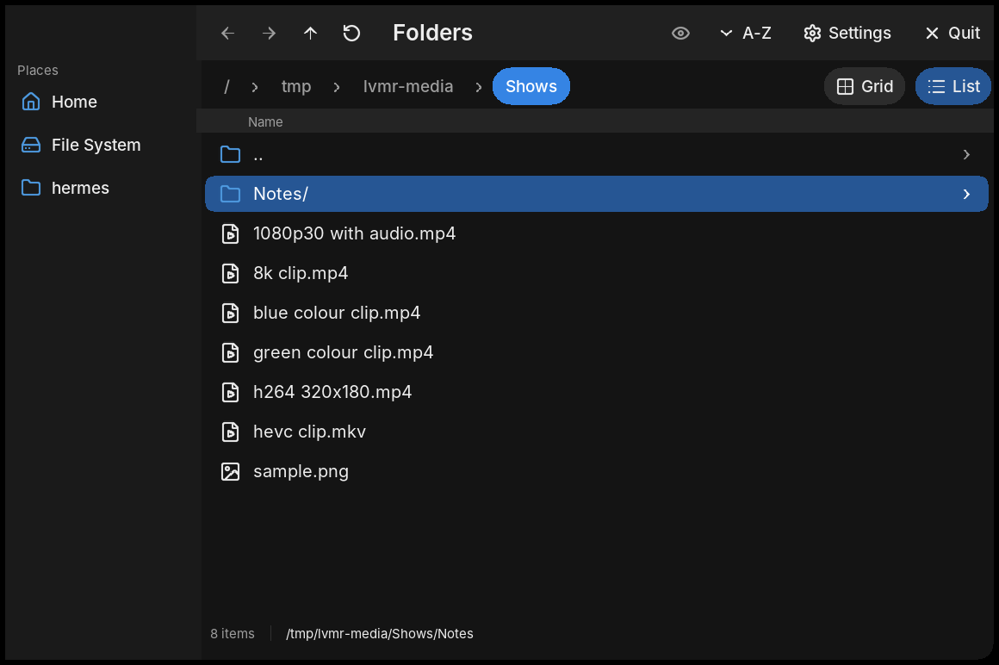
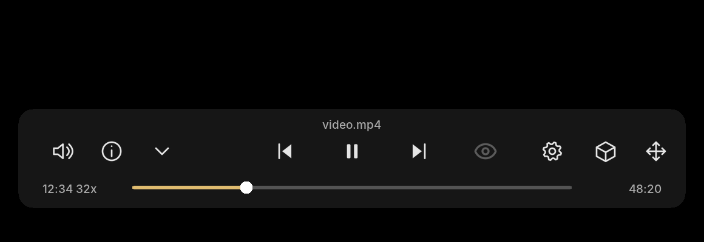

# LumaFrameVR

A VR media player for the Steam Frame, native to the headset: C++20, Vulkan and OpenXR, with
FFmpeg for decoding and PulseAudio for output. It browses a folder, plays video in flat, 180,
360 and fisheye projections.



The file viewer: list and grid views, sorting, optional folder
thumbnails and a preview panel. Layout illustration drawn from the UI code.



The video controls: the transport bar, the volume popup, rotation and viewer advanced
settings. H.264, HEVC and VP9 decode through V4L2 memory-to-memory when the VPU offers it and
fall back to software when it does not.

Decoding covers eight- and ten-bit 4:2:0, so HEVC Main10 and VP9 profile 2 play through the
software path, packed to P010 and uploaded in the same two-plane format the VPU's own P010
frames are imported in. AV1 follows the software AV1 decoder the linked FFmpeg carries: FFmpeg
7's native `av1` entry cannot decode without a hardware accelerator, so it takes `libdav1d` or
`libaom-av1`, and the frame's FFmpeg has libdav1d — AV1 plays there. A build with neither refuses
an AV1 file with that reason rather than half-playing, which is what a hwaccel-only entry would do.

## What is in the repository


The same list as text, so it stays searchable:

- `cpp/` the application: OpenXR session, Vulkan renderer, UI scenes, browser, playback, persistence
- `cpp/tests/` the acceptance suite, plus the scripts that drive it and provision its media
- `shaders/` GLSL shaders for the renderer
- `cmake/` one module per subsystem: build targets, payload assembly and test registration
- `installer/` `install.sh`, the Steam helper, the double-click entries and their tests
- `scripts/` build, cross-compile, verification, packaging, atlas and fixture helpers
- `tests/` the updater's Python tests
- `docs/` architecture, build, install, packaging, localization and the C++ guidelines
- `assets/` branding, browser, eye and transport artwork, each with its source SVG, rasteriser or provenance record
- `licenses/` dependency notices and how to keep them
- `CMakeLists.txt` project version and build entry point; `CMakePresets.json` the native and Frame presets; `build.sh` the release build wrapper
- `cmake/PackageRelease.cmake` packs a verified payload into the release archive; `launch.sh` sets the runtime environment
- `get-lumaframevr.sh` the one line installer
- `update.sh` and `update.py` the in-place updater and the manifest it checks
- `.github/` continuous integration and the issue and pull request templates
- `README.md` this overview, `README.user.md` the user guide
- `LICENSE` the GPL-3.0 text, `CODE_OF_CONDUCT.md` how we behave here
- `AI-USAGE.md` the AI policy, `CONTRIBUTING.md` how to work here

## Install

On the Steam Frame, one line:

```sh
curl -fsSL https://raw.githubusercontent.com/GitHubStefan13/LumaFrameVR/main/get-lumaframevr.sh | sh
```

That finds the newest published release, checks it against the checksum published with it, and runs
the installer. No root, no Python.

Take `lumaframevr-desktop-installer-<version>-<build>.run` and its `.sha256` companion from the project's
release assets, then in the folder you downloaded them to:

```sh
sha256sum -c lumaframevr-desktop-installer-<version>-<build>.run.sha256
chmod +x lumaframevr-desktop-installer-<version>-<build>.run
./lumaframevr-desktop-installer-<version>-<build>.run --ui
```

Double-clicking the file works too. Dialogs come from kdialog or zenity when one of them is
installed, and fall back to plain prompts otherwise, which is also the route over SSH:

```sh
./lumaframevr-desktop-installer-<version>-<build>.run --install --no-steam
```

Installing needs no root and no Python. Python 3 is used for one thing only, the optional
Steam shortcut, because Steam keeps non-Steam games in a binary file. The player needs an
ARM64 SteamVR or OpenXR runtime that is already installed; the installer downloads nothing.

Everything lands under `~/.local`: the release in `opt/lumaframevr/releases/<version>`, a `current`
symlink, the command in `bin/lumaframevr`, a desktop entry, an icon, a record of what was
created, and a log. Settings live in `~/.config/lumaframevr` and thumbnails in
`~/.cache/lumaframevr`; both survive an uninstall unless you ask for `--purge`.

From a directory bundle, run `./install.sh` instead. Actions: `--install` (the default),
`--repair`, `--uninstall [--purge]`, `--steam-add`, `--steam-remove`, `--plan`. Options:
`--ui` / `--no-ui`, `--steam` / `--no-steam` (it asks by default), `--yes`, `--prefix DIR`,
`--payload FILE`, `--add-to-path`, `--help`. [docs/INSTALLATION.md](docs/INSTALLATION.md) has
the layout, the checksums and the repair path.

### On the Steam Frame: terminal, SSH, or the desktop's browser

All three routes install the same release for the current user. None needs root, and nothing is
written outside `~/.local`, `~/.config/lumaframevr` and `~/.cache/lumaframevr`.

**In Desktop Mode's terminal.** Switch to Desktop Mode, open the terminal (Konsole), and paste the
one line from above:

```sh
bash -o pipefail -c 'curl -fsSL https://raw.githubusercontent.com/GitHubStefan13/LumaFrameVR/main/get-lumaframevr.sh | sh'
```

It reads the version from this repository, downloads that release's installer, checks it against the
checksum published beside it and installs it, asking about the Steam shortcut. `LUMAFRAMEVR_NO_STEAM=1`
in front skips that question, and `LUMAFRAMEVR_KEEP=1` keeps the downloaded file. `bash -o pipefail`
rather than a bare `| sh` is deliberate: without it a failed download installs nothing and still
reports success.

**Over SSH, with developer mode on.** Turn developer mode on in the frame's settings, which also
starts its SSH server, and then from another machine — the same access `scripts/make-aarch64-sdk.sh`
uses, `steamos@frame` by default:

```sh
ssh steamos@<frame> "bash -o pipefail -c 'curl -fsSL https://raw.githubusercontent.com/GitHubStefan13/LumaFrameVR/main/get-lumaframevr.sh | sh'"
```

Install as the user that runs the player rather than as root: the release goes into that user's home.

**From the desktop's browser, without typing anything.** Download
`lumaframevr-desktop-installer-<version>-<build>.run` from the release page with Chromium into
`~/Downloads`, then double-click **Install LumaFrameVR (downloaded installer)** — the entry in
`installer/`, shipped in the release's directory bundle — which hands the newest `*.run` in
`~/Downloads` to `sh` for you. That matters because a browser writes the download without its
execute bit, and a filesystem may be mounted `noexec`. KDE runs a `.desktop` only once the file is
executable, so if double-clicking opens it as text, right-click → Properties → Permissions →
*Is executable*. The same thing from a terminal is:

```sh
sh ~/Downloads/lumaframevr-desktop-installer-*.run --ui
```

Whichever route, the player needs an ARM64 SteamVR or OpenXR runtime that is already installed, and
the installer downloads nothing else.

## Build

```sh
cmake -S . -B build-host
cmake --build build-host --parallel 2
ctest --test-dir build-host --output-on-failure
```

`build.sh` runs the same build for a release configuration. Cross-compiling for the Frame is
covered in [docs/BUILD.md](docs/BUILD.md), and [docs/DEVELOPMENT.md](docs/DEVELOPMENT.md) lists
the fixtures and environment variables the tests expect.

## Documentation

- [Architecture](docs/ARCHITECTURE.md): components and how data moves between them.
- [Build](docs/BUILD.md): host, release and ARM64 cross builds.
- [Development](docs/DEVELOPMENT.md): tests, fixtures and release tooling.
- [Installation](docs/INSTALLATION.md): the installer, repairs and logs.
- [Localization](docs/LOCALIZATION.md): the language-file format.
- [Controllers](docs/CONTROLLERS.md), [Video pipeline](docs/VIDEO-PIPELINE.md),
  [Passthrough](docs/PASSTHROUGH.md).
- [C++ guidelines](docs/CPP-GUIDELINES.md): how code in this repository is written.
- [AI usage](AI-USAGE.md): AI is allowed here, disclosed, and always human reviewed.

## Licensing

LumaFrameVR is free software under the **GNU General Public License, version 3 or later**.
The full text is in [LICENSE](LICENSE).

You may use, study, change and share it, including commercially. If you distribute it, or a
version you changed, you have to pass on the same freedoms and the complete corresponding
source, and you cannot relicense it or hide it inside a closed-source product. There is no
warranty.

Everything the package uses is compatible with that. FFmpeg is LGPL-2.1-or-later, Mesa MIT, the
OpenVR header BSD-3-Clause and the Vulkan loader Apache-2.0. They keep their own
terms, listed in [licenses/README.md](licenses/README.md), and the notices inside each package. The
package ships no FFmpeg of its own: the player links the one the frame already has, so its
licence travels with the frame. Valve's SteamVR runtime and the Steam client are proprietary and are
not distributed here; the player only talks to them at runtime.

## How the project is laid out

```
LumaFrameVR
├── cpp/            the player
│   ├── application/  frame loop, controllers, panels
│   ├── browser/      the folder viewer over the media library
│   ├── diagnostics/  probes, metrics and the profile report
│   ├── graphics/     Vulkan: device, video image, DMABUF import, presentation
│   ├── headset/      OpenXR session, input, composition, passthrough
│   ├── i18n/         the language catalogues
│   ├── input/        controller state, pose filtering and the panel pointer
│   ├── media/        decoding and audio: FFmpeg, V4L2, PulseAudio
│   ├── playback/     the decode worker and the playback timeline
│   ├── presentation/ projection, layout, colour and remembered settings
│   ├── preview/      thumbnails: fetching, cache and disk store
│   ├── source/       what a file is, and where a media source comes from
│   ├── tests/        the acceptance suite and its helpers
│   └── ui/           the panels, the browser chrome, the baked typeface and icons
├── shaders/        GLSL shaders for the renderer
├── cmake/          one module per subsystem, nothing else
├── assets/         inputs for the generated atlases and the branding
├── docs/           build, development, architecture, publishing
├── installer/      the desktop installer and the Steam shortcut helper
├── scripts/        build, packaging, atlas and fixture tooling
├── tests/          the updater's Python tests
└── LICENSE, README.md
```
